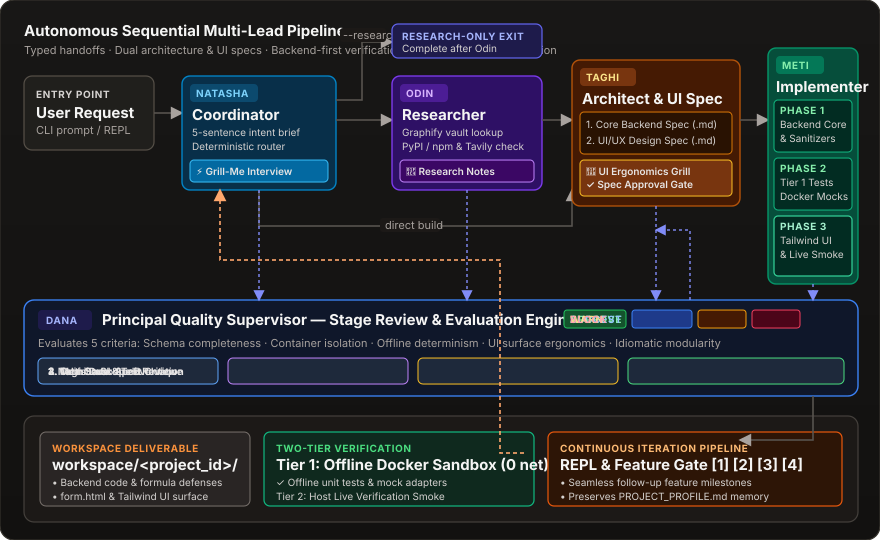

<div align="center">


# BuildRelay

A local Python CLI for planned, phase-checked, resumable AI development.

Version <!-- package-version:start -->0.2.0<!-- package-version:end --> · Python 3.11+ · Experimental

[Documentation](https://dutch-panda.github.io/BuildRelay/) · [Quick start](#quick-start) · [CI results](https://github.com/Dutch-panda/BuildRelay/actions/workflows/tests.yml) · [Issues](https://github.com/Dutch-panda/BuildRelay/issues)
</div>

BuildRelay routes a request through selected research, architecture and implementation roles. It records plans, Docker phase-check results and checkpoints so you can inspect and continue work. Human alignment and approval points help clarify the task; they do not guarantee correctness. Optional supervision and static scores provide signals, not independent acceptance evidence.

## Who it is for

For developers able to review generated code who want a local planning, execution and recovery record. Bounded utilities/prototypes with explicit inputs, outputs and deterministic checks are useful starting points. These are design-fit suggestions, not measured success rates.

Consider a simpler coding session for a tiny known edit, and a different process for production deployment, compliance or independently audited security. See [task fit](docs/content/task-fit.md) and the [proposed rationale, pending owner review](docs/content/design.md).



## Quick start

You need Python 3.11+, Git, Docker running and an eligible model connection. Remote providers may transmit prompts/context and incur API charges or require a subscription. Local inference requires an appropriate endpoint and resources. Obsidian is optional.

```bash
git clone https://github.com/Dutch-panda/BuildRelay.git
cd BuildRelay
python3 -m venv .venv
source .venv/bin/activate
python -m pip install -e .
docker info
python main.py config
```

On Windows, use `.venv\Scripts\Activate.ps1` for activation. The wizard selects one connection and models for the leads. Discovery/sign-in can contact providers; setup does not guarantee model availability or successful execution. Do not share credentials in prompts or recordings.

Before accepting a generated plan, review its scope/checks. Docker networking remains enabled. Workspace files—including a project `.env`—are readable by code in the container mount.

```bash
python main.py "Build a small Python CSV validator with a CLI. Require name and amount columns, report invalid amounts, and include valid and invalid fixtures, automated tests, and README run instructions." --project csv-demo --image python:3.11-slim --step
```

This is a **suggested task, not a recorded successful run**. The [full first-run guide](docs/content/quickstart.md) explains the wizard, approval points, failures and result inspection. Manual options belong in the [configuration reference](docs/content/configuration.md).

## Inspect the output

Generated files live in `workspace/csv-demo/`. Read its README and inspect valid/invalid fixtures, the test command and recorded exit statuses. Stage notes live under `vault/`; implementation reports are in `vault/code-reviews/`. A zero exit code does not establish complete tests or security.

The [historical CLI/offline-test capture](docs/content/example.md) shows genuine help/test output, not a live build. A [Flask form-to-PDF showcase](docs/content/showcase.md) remains pending sanitized owner evidence and approval.

## Resume or iterate

Press Ctrl+C to request interruption. Inspect files, running containers and side effects before retrying: in-flight work can have unknown effects and may run again. `.state/tasks.db` records progress; it does not back up source or guarantee exactly-once execution.

```bash
python main.py --resume YOUR_PRINTED_TASK_ID
```

Back up ledger, workspace and vault together. Reuse the project ID for follow-up tasks, or use `buildrelay --session csv-demo`. Read [resume](docs/content/resume.md), [project tools](docs/content/project-tools.md) and [command boundaries](docs/content/commands.md) first: **REPL `/test` runs host commands, not Docker tests**, and may execute a generated live script.

## Critical boundaries

- Review generated code. Live verification executes generated scripts **on the host** with its environment/project credentials; it can change external services.
- Preview serves workspace files, not an authenticated app server or browser test. Review sensitive contents before serving them.
- Supervision critiques supplied context. Static scores use file/text heuristics; they do not prove coverage, security, usability or correctness.
- Search snippets/package metadata are not full-page claim-level evidence. URL checks and registry error semantics have limits.
- Per-task locks do not isolate different tasks editing one shared project. Human review and backups remain necessary.

Read [limits and security](docs/content/limitations.md) before host verification or generated execution.

## Reference guides

Maintained Markdown sources below also generate the website. Earlier README section anchors are retained as onward links.

- <a id="how-the-workflow-runs"></a><a id="interactive-alignment-and-execution-modes"></a>[Workflow and alignment](docs/content/workflow.md)
- <a id="tiered-model-routing-and-token-optimization"></a><a id="token-usage-and-cost-analytics"></a>[Models, legacy tiers and usage estimates](docs/content/configuration.md)
- <a id="execution-and-validation"></a><a id="web-and-documentation-search-with-guardrails"></a><a id="dynamic-progress-and-project-delivery"></a>[Execution, validation and research](docs/content/execution.md)
- <a id="keep-related-tasks-connected"></a><a id="what-stays-on-disk"></a>[Project memory and storage](docs/content/projects.md)
- <a id="resume-a-task"></a>[Resume](docs/content/resume.md)
- <a id="project-repl-live-verification-and-ui-preview"></a>[Sessions, verify and preview](docs/content/project-tools.md)
- <a id="quality-supervision-and-evaluation"></a>[Supervision and evaluation](docs/content/quality.md)
- <a id="component-connections"></a><a id="repository-map"></a><a id="development-and-documentation"></a><a id="brand-assets"></a>[Architecture, repository map and brand](docs/content/architecture.md)
- <a id="testing"></a>[Tests and integration checks](docs/content/testing.md)
- <a id="security-and-isolation-boundaries"></a><a id="current-limitations"></a>[Limits and security](docs/content/limitations.md)
- <a id="troubleshooting"></a>[Troubleshooting](docs/content/troubleshooting.md)

## Maintenance and reuse

Maintainer: Ehsan. [Report reproducible issues or propose changes](https://github.com/Dutch-panda/BuildRelay/issues) with sanitized steps and commit/version; never include credentials or private project data. No support SLA or response time is promised.

Licensed under [MIT](LICENSE), selected by the owner. Dependencies/assets retain their own notices; the project license does not replace them.

The proposed repository description is recorded in the [documentation review](docs/reviews/2026-11-02/REPORT.md); remote settings remain unchanged.

Edit `docs/content/*.md`, then regenerate locally:

```bash
python scripts/build_docs.py
```

The builder reads the package version from `pyproject.toml`, updates only the marked version above and regenerates the site. See [source ownership](docs/content/README.md). This command does not deploy.
