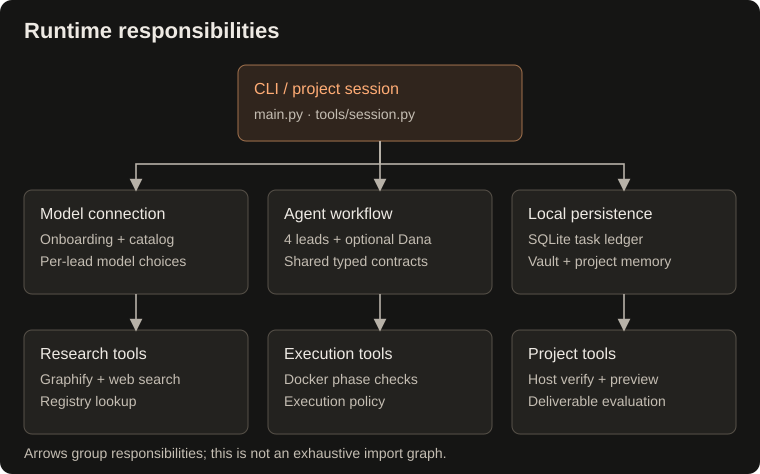

## Component connections



Arrows show which component uses another. Shared contracts define stage outputs, handoffs, and checkpoints used by orchestration, agents, and the ledger. Vault tools support graph lookup and project-note links; each agent saves its own stage artifacts.


## Repository map

```text
.
├── main.py                    CLI, task IDs, routing, and orchestration
├── contracts/
│   └── __init__.py            Shared typed checkpoints, stage outputs, and handoff contracts
├── agents/
│   ├── natasha.py             Structured briefs and routing
│   ├── odin.py                Research reports
│   ├── taghi.py               Specifications and outcome-driven execution phases
│   ├── diba.py                UI/UX design systems, Tailwind tokens, and interactive states
│   ├── execution_policy.py    Phase validation ordering, retry budgets, and recovery policy
│   ├── review_renderer.py     Markdown code review report rendering
│   ├── meti.py                Implementation coordination and Docker tools
│   └── dana.py                Principal Quality Supervisor & autonomous overseer
├── tools/
│   ├── chatgpt_auth.py        OAuth credential storage and model setup
│   ├── claude_auth.py         Claude OAuth web subscription and headless login
│   ├── cockpit.py             Split-Pane Terminal Cockpit, live telemetry, and heartbeat ticker
│   ├── context_pruner.py      Markdown stripping, graph context ranking, and Docker log slicing
│   ├── design_system.py       Curated visual blueprints and Tailwind design archetypes
│   ├── docker_runner.py      Container lifecycle and workspace mounts
│   ├── eval_harness.py       Automated multi-dimensional deliverable evaluation
│   ├── graphify_tool.py      Graph extraction, node search, and neighbors
│   ├── grill.py              Interactive Grill-Me interview and alignment engine
│   ├── live_verifier.py      Tier 2 guided live verification smoke runner
│   ├── onboarding.py         Interactive provider setup and local .env persistence
│   ├── web_search.py         Search results, URL checks, page helper, and registry lookup
│   ├── model_tiers.py        Tiered routing presets, budget estimation, and lead overrides
│   ├── project_notes.py      Project IDs, note creation, and shared links
│   ├── session.py            Continuous conversational project REPL
│   ├── task_ledger.py        SQLite checkpoints and per-task process locks
│   ├── token_analytics.py    Token usage tracking, model pricing, and summary tables
│   ├── ui.py                  Terminal styling, agent color badges, panels, and phase tables
│   ├── ui_preview.py         Local web preview server for generated input surfaces
│   └── vault_infra.py        Safe Markdown writing, graph tool wiring, and graph updates
├── .github/workflows/tests.yml  Automated platform tests
├── tests/                    Deterministic platform tests
├── scripts/validate.py        Local test runner
├── docs/index.html           GitHub Pages presentation
├── pyproject.toml            Package metadata and dependencies
├── vault/                    Local Markdown knowledge base
└── workspace/                Generated task workspaces
```


## Development and documentation

The installed distribution provides the console script entry point `buildrelay` (e.g. `buildrelay "prompt"` or `buildrelay config`), or you can run directly from the checkout with `python main.py`. Runtime dependencies and Python requirements are declared in [pyproject.toml](../../pyproject.toml); dependency versions are lower bounds rather than a locked environment.

The agent classes can also be called directly with a `model_name` (model string or Pydantic AI model object) and a `vault_path`. Agents support explicit dependency injection: `graph_manager`, custom artifact storage directories (`tasks_dir`, `research_dir`, `specs_dir`, `code_reviews_dir`), and `MetiImplementer` additionally accepts custom `sandbox` runners (e.g. `DockerSandboxRunner` or mock test runners). Constructors defer Docker connections and directory creation until operations actually require them. Programmatic Meti calls can supply `checkpoint`, `checkpoint_callback`, and a new `run_number` to persist and restore implementation progress; the CLI connects these to the ledger automatically. The CLI resolves explicit per-lead choices from the selected provider connection. Legacy configurations can still use tier presets. Collaborator injection and custom artifact-directory options are programmatic interfaces, not CLI flags.

### Website documentation

The README is the short entry point. Full guides live in maintained `docs/content/*.md`; the generator maps these sources to stable HTML URLs. Shared navigation, metadata, heading IDs, source links and package-derived version live in `scripts/build_docs.py`. Styles and progressive enhancement live in `docs/site.css` and `docs/site.js`. The introduction and historical example also have maintained sources. See [source ownership](README.md).

```bash
python scripts/build_docs.py
```

This command writes local files and does not publish or run examples. Historical artifacts retain their recorded provenance; they are not relabeled as current output.


## Brand assets

The selected logo is **Forward B**, an orange BuildRelay monogram. Use [the canonical SVG](../brand/logo.svg) for the README, website, and icon applications. See [brand usage](../brand/README.md) for sizing and color guidance.
