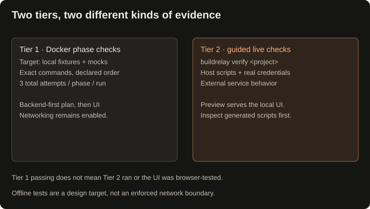

## Execution and validation

Tier 1 passing does not mean live verification ran. The preview server serves files; it does not independently test browser behavior or visual quality.

- Each command runs in a **fresh Docker container**, with the project or task workspace mounted at `/app/workspace/<task_id>/`.
- Files in that mount persist across commands. Container-local installs and changes outside it do not; keep durable dependencies in the mounted directory.
- **Outcome-Driven Phase Scaling:** Execution phases are scaled dynamically based on task scope (1 phase for focused CLI utilities up to 5 phases for full-stack apps). An anti-doc-only safeguard rejects plans containing only markdown or documentation without functional code and tests.
- Each phase must pass its **exact validation command**, submitted separately with its phase name, in the declared order. Successful command exit codes are recorded as validation results.
- Failed phase validation returns combined stdout/stderr to Meti with the remaining attempt count. Meti can repair and rerun the same check, up to **three validation attempts per phase per run** (one initial attempt and two retries). The third failure stops execution before more sandbox commands or later phases.
- Straightforward tasks receive a fast-track phase that asks Meti to create and run a task-specific validation script.
- The runner defaults to a **120-second wait timeout** per command and removes the container after execution.

### Recovery and attempt history

When a validation command fails, Meti receives its output and can issue repair commands before retrying that phase. Rejected calls with the wrong phase or validation command do not consume an attempt. Running an exact declared validation command without its phase name is rejected. Repair commands are separate from the three-attempt validation budget.

If the model returns a final response while a failed phase still has attempts remaining, the application sends the failure logs back into the same conversation. If that recovery round returns without another validation attempt, the run ends as failed rather than repeatedly asking without progress. Model-run errors and retry exhaustion also produce a failed review note.

The review note records each phase's attempt number, command, exit code, captured output, and final resolution: passed, passed on retry, retry limit exhausted, stopped early, or not validated. Docker wait/execution errors preserve available container logs; image acquisition errors return failure feedback. This is bounded recovery within a run; `--resume` reuses saved progress and starts a new run budget. Neither mechanism guarantees that an autonomous repair will succeed.

## Web and documentation search with guardrails

Natasha and Odin have documentation search tools; Odin also has package registry lookup:

- **Web Search:** Uses DuckDuckGo HTML search without a search API key, with optional `TAVILY_API_KEY` support. Natasha receives up to two results per lookup; Odin receives up to three.
- **URL Checks:** Rejects non-HTTP(S) URLs, selected local hostnames, and literal private, loopback, link-local, reserved, or multicast IP addresses. These checks do not resolve DNS or revalidate redirects, so they are not a complete SSRF defense. The optional Tavily integration sends a POST request to its search API.
- **Page Extraction Helper:** `tools/web_search.py` includes `fetch_web_page`, which extracts text from HTML and limits extracted content to 3,000 characters by default. This helper is not currently registered as an agent tool: research uses search snippets rather than full page reads. The character cap is not a response-download limit or a precise token cap.
- **Package Registry Lookup:** Odin can query PyPI or npm for a package name and latest release metadata. Registry presence does not establish authenticity, suitability, or safety. On connectivity errors the helper currently returns `exists=True` with a verification-skipped note, and the agent wrapper can label that result verified; independently verify dependencies before use.
- **Search Call Budget:** Odin allows at most **three search calls per research invocation**, including cached lookups. This does not limit Natasha lookups or registry calls. Recorded external sources are search-result URLs, not claim-level citations or evidence of full-page reading.
- **Local Disk Caching:** Successful query results are cached under `.state/search_cache/`. Reuse avoids another search request, but returned snippets still consume model context. There is currently no cache expiry.

## Dynamic progress and project delivery

- **Live Progress Spinners:** Active Docker operations and LLM generation phases display animated Rich status spinners (`rich.status.Status`) instead of terminal dumps.
- **Clean Execution Logs:** Docker stdout and stderr are routed to `.state/task.log`. Set `BUILDRELAY_DEBUG=1` to echo full container outputs directly to the terminal.
- **Anti-Simulation Invariant & Real Data Flow:** Frontend and CLI surfaces must wire directly to real backend endpoints or verified persistent storage (SQLite, local files, or structured localStorage). Simulating actions with fake `setTimeout` stubs, hollow mock promises, or "preview only" disclaimer messages is strictly prohibited.
- **5 Discrete UI Interaction States:** Input surfaces must concretely handle all 5 interaction states: `empty` (default clean state), `validating` (inline validation feedback), `submitting` (loading spinner / disabled controls), `success` (confirmation / data saved alert), and `error` (actionable recovery hints).
- **Meti Delivery Confirmation Gate:** Pauses after phase checks pass to present an interactive delivery summary, file tree, and quickstart commands, letting users accept (`[Enter]`/`[c]`) or request follow-up refinements (`[r]`) in a live loop before closing the task.
- **User-First Deliverables Mandate:** System prompts mandate beginner-friendly READMEs with visual architecture/dataflow diagrams, plain-language quickstarts and lightweight setup scripts (`scripts/setup.js`). These are prompt instructions, not guaranteed dependency-free delivery.
- **Auto-Generated Workspace README:** Meti creates a fallback `README.md` in the project or standalone task workspace when one is missing or empty, with architecture, run, and validation guidance. Existing nonempty READMEs are preserved; review the instructions against the generated project.
- **Workspace File Tree:** Renders a clean `rich.tree.Tree` showing generated project files while filtering noisy build artifacts (`__pycache__`, `.git`, `.venv`).
- **How to Run & Test Banner:** Displays prominent quickstart commands based on the detected project stack (e.g. Python, Node.js, Rust, Go).
