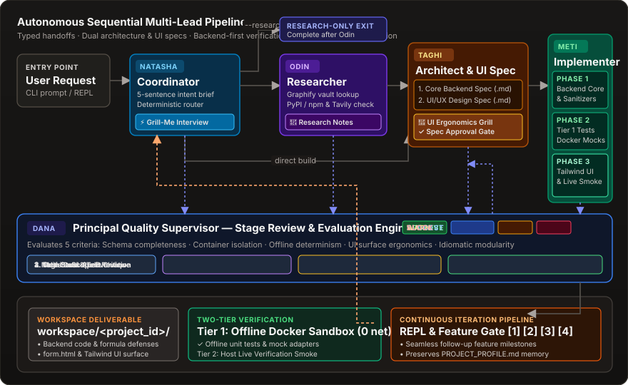

A local Python CLI for AI development
<h1>Plan. Build. Check. Keep your progress.</h1>
Clarify your request, approve a technical plan, and build through recorded Docker phase checks. Resume saved work and evolve the same project.

<a class="button primary" href="quickstart.md">Run your first task →</a><a class="button" href="example.md">See the terminal example</a>

<a href="workflow.md"><strong>Align &amp; approve</strong>Intent interviews, backend and UI specs, and approval gates.</a><a href="execution.md"><strong>Build &amp; check</strong>Ordered phases, recorded results, and bounded repair attempts.</a><a href="projects.md"><strong>Resume &amp; iterate</strong>Saved checkpoints, project memory, and follow-up features.</a>

<strong>Status:</strong> experimental developer tool. <a href="task-fit.md">Task fit and simpler alternatives →</a>
<h2 id="how-it-works">How it works</h2>
Natasha routes your request to research, architecture, or implementation. Research-only requests end after Odin. Optional Dana supervision adds model critiques at stage boundaries.

Natasha
<strong>Routing &amp; alignment</strong>
Clarify intent and select the route.

Odin
<strong>Research</strong>
Retrieve vault context, web snippets, and package metadata.

Taghi
<strong>Architecture</strong>
Define backend specifications and validation phases.

Diba
<strong>UI/UX Design</strong>
Craft studio-grade design systems and interactive states.

Meti
<strong>Implementation</strong>
Execute Docker commands and record phase checks.

<h2 id="quality-signals">Quality signals</h2>
Use phase results, optional Dana model critiques, and a separate static evaluation scorecard together. Scores are diagnostic signals—not proof of correctness or security.

<a href="quality.md"><strong>Supervision &amp; evaluation</strong>Advisory or autonomous steering, audit notes, and heuristic scorecards.</a><a href="execution.md"><strong>Two verification tiers</strong>Docker checks first; guided live scripts run separately on the host.</a>

<a href="showcase.md">Flask form-to-PDF showcase: owner evidence pending →</a>
<h2 id="start-here">Start here</h2>
<a href="quickstart.md"><strong>Install &amp; choose models</strong>Connect a provider and select models for each lead.</a><a href="project-tools.md"><strong>Work on an existing project</strong>Use sessions, live verification, and local UI preview.</a><a href="architecture.md"><strong>Explore the architecture</strong>Typed handoffs, persistence, and execution policy.</a><a href="testing.md"><strong>Run platform tests</strong>Offline unit tests and opt-in integration checks.</a>
<h2 id="before-you-run">Before you run</h2>

BuildRelay is an early-stage local developer tool. Docker networking is enabled. Project credentials inside the mounted workspace are accessible to container code. Live verification executes generated scripts on the host. Review generated code, scripts, and test quality before relying on results. <a href="limitations.md">Read the limits and security guide →</a>

