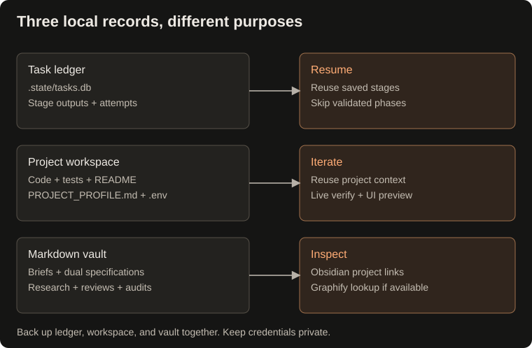

## Keep related tasks connected

Reuse a project ID across requests:

```bash
python main.py "Design a SQLite-backed task tracker" --project task-tracker
python main.py "Build a CSV import utility for a task tracker" --project task-tracker
```

### Interactive Project REPL Session

Use [project tools](project-tools.md) to start a session and the [canonical command table](commands.md) for dispatch/side effects. `/test` uses host commands, not Docker.

### Project Memory on Disk (`PROJECT_PROFILE.md` & Local `.env`)

BuildRelay creates `vault/projects/<project_id>.md` and initializes `workspace/<project_id>/`:
- **`PROJECT_PROFILE.md`**: Living specification recording active data schemas, input surfaces, architectural rules, and task history. Natasha and Taghi automatically load this memory into prompt context, providing recorded context for iteration; schema drift remains possible.
- **`.env` (mode `0600`)**: Dedicated project secrets file, automatically gitignored.
- Produced briefs, reports, specifications, and implementation reviews include a visible project link and frontmatter:

```yaml
project: "[[projects/task-tracker]]"
```

Project IDs accept letters, digits, underscores, and hyphens, and must start with a letter or digit. Project grouping links the notes and codebases: tasks sharing a project ID share the same workspace (`workspace/<project_id>/`), allowing successive tasks to build upon existing project modules and tests. Resumed runs reuse that task's workspace. Standalone tasks without a project ID use `workspace/<task_id>/`.



Open **`vault/` as an Obsidian vault** to browse the notes and project wikilinks. Those links work independently of Graphify.

Graph updates are automatically synchronized after stage artifacts are saved. In addition to Graphify extraction, BuildRelay includes an offline wikilink graph parser that indexes Markdown notes without external LLM dependencies, automatically injecting connected tasks, specifications, and code-review nodes into Natasha and Taghi's prompt context during repeated project workflows.

### Research source references

Odin records nodes retrieved from its initial task lookup and its search and neighbor-query tools. Search matches node IDs, labels, source-file paths, and properties. Each saved research report includes a **Related vault sources** section with relative Markdown links and corresponding wikilinks in its `links` frontmatter.

Source paths come from Graphify's `source_file` metadata, including that field inside `properties` when present. Only existing Markdown files inside the vault are listed; duplicate paths are removed, and missing files or paths outside the vault are omitted. The returned `ResearchReport.vault_sources` contains the same vault-relative paths, overriding any model-generated list.

These references identify retrieved graph context. They do not establish that the full source notes were read or that each finding is supported by a particular note. If no source files can be resolved, the report states that explicitly. Graph extraction still requires a working Graphify backend.


## What stays on disk

Each new task gets a permanent ID shaped like `task-<prompt-slug>-YYYYMMDD` (e.g. `task-build-csv-validator-20261026`). The slug is derived from the prompt before any model call; resume keeps the same ID.

```text
.state/tasks.db                      Local workflow ledger and checkpoints
.state/<task_id>.lock                Local process lock file (may remain after exit)
.state/task.log                      Shared execution log
.state/search_cache/                 Cached web search results (no expiry)
workspace/<project_or_task_id>/       Generated source, tests, docs, dependencies
vault/
├── tasks/<task_id>-brief.md          Routing brief with the permanent task ID
├── research/research-<task_id>.md     Research report, when Odin runs
├── specs/                           Backend and UI specifications, when Taghi runs
├── supervision/                     Optional Dana critiques
├── evaluations/                     Static deliverable scorecards
├── code-reviews/review-<task_id>.md   Implementation summary and validated phases
├── projects/<project_id>.md          Optional shared project note
└── .graphify/graph.json              Knowledge graph, when available
```

The local `.state/` directory, generated workspace files, stage notes, and graph artifacts are ignored by Git. Project notes under `vault/projects/` are **not currently ignored**; review them before committing.
