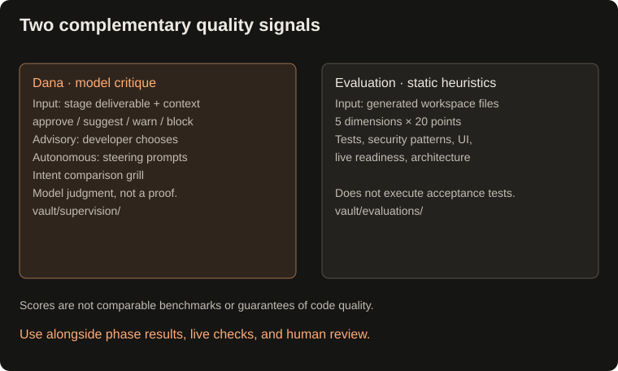

## Quality supervision and evaluation

### Dana quality supervision
- Evaluates deliverables across every stage (Natasha intent brief, Odin research report, Taghi architecture spec, Meti container deliverable) against **5 Technical Pillars**:
  1. **Executable Backend & Intent Fulfillment:** Verifies genuine working backend logic, real data handlers, and client persistence (strictly rejecting simulated stubs, mock `setTimeout` handlers, or "preview only" fake flows).
  2. **Test Rigor & Offline Determinism:** Enforces containerized unit tests with strict deterministic assertions; flags hollow assertions like `assert True`.
  3. **Security & Sanitization:** Checks for formula injection sanitization (`=`, `+`, `-`, `@`), credential protection, and environment hygiene.
  4. **UI/UX Usability & 5 Discrete States:** Requires full coverage of interactive states (`empty`, `validating`, `submitting`, `success`, and `error`) with responsive layouts and clear validation messages.
  5. **Code Modularity & Living Memory:** Enforces clear separation of concerns, clean file layout, and alignment with `PROJECT_PROFILE.md`.
- **Anti-Paralysis Invariant:** Terminal developer approval at gates constitutes complete authorization to build end-to-end working software. Dana never blocks implementation or downgrades code to mock previews waiting for further stakeholder decisions.
- **Telegraphic Card Format:** Terminal output uses compact, high-density military bullet cards (`+` strengths, `▲` risks/gaps, `➔` actionable recommendations) while persisting full narrative critique notes in `vault/supervision/`.
- **Advisory Mode (`--supervise advisory` or `--dana`):** Presents a structured quality critique card with score, strengths, risks/gaps, and actionable recommendations. Allows you to `[Enter]` proceed, `[a]` apply recommendations to the lead for automatic revision, `[s]` skip, or `[q]` abort.
- **Autonomous Mode (`--supervise autonomous`):** Detects warnings or blocking gaps and autonomously steers the lead with corrective prompts without interrupting human flow.
- **Off Mode (default):** Keeps execution lean and direct when supervision is not needed.
- **Override Model:** Configure Dana via `--model-dana` or `MODEL_DANA` in `.env`.
### Deliverable evaluation
- Evaluates completed deliverables across 5 engineering dimensions (up to 20 pts each, 100 max):
  - **Dimension 1: Test Integrity & Coverage:** Uses file/text indicators for selected test/assertion/mock patterns; it does not execute tests or measure coverage. Flags hollow assertions like `assert True`.
  - **Dimension 2: Security & Sanitization:** Looks for selected CSV/spreadsheet sanitization patterns (`=`, `+`, `-`, `@`), looks for selected secret-like literals and environment patterns; absence of a match does not establish safety.
  - **Dimension 3: UI Surface & Usability:** Looks for file/text indicators of user entry points (`form.html`, responsive styling, field constraints, interactive CLI).
  - **Dimension 4: Tier 2 Live Verification Readiness:** Checks for dedicated smoke test scripts (`scripts/verify_live.py`) decoupled from mock fixtures, plus actionable numbered checklists in `README.md`.
  - **Dimension 5: Architectural Conformance & Hygiene:** Looks for indicators of separation of concerns, living `PROJECT_PROFILE.md` memory, and documentation.
- **CLI Command:** `buildrelay --eval [project_id|task_id]` or `python main.py --eval [project_id|task_id]`.
- **Project REPL Command:** `/eval` inside `buildrelay --session <project_id>`.
- **Persistent Reports:** Saves heuristic Markdown evaluation reports in `vault/evaluations/eval-<task_id>.md`.

Dana receives stage deliverables and context; it is not a guaranteed full-file or diff review. Autonomous steering does not establish that every finding was repaired or independently re-reviewed. The evaluation harness uses file and text heuristics: its score is a diagnostic signal, not measured test coverage, a security audit, or a cross-project benchmark.
