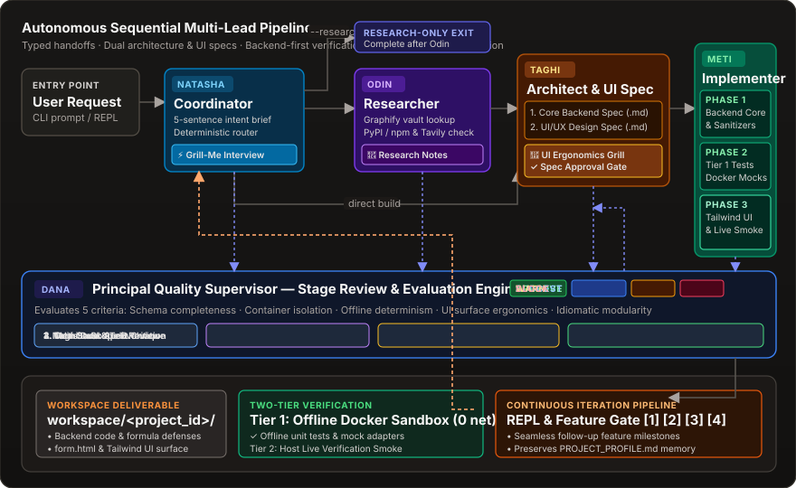

## How the workflow runs

- **Natasha — coordinator:** produces a typed task brief, a 5-sentence intent alignment brief, and conducts an interactive Grill-Me interview (up to 15 questions across 4 operational pillars: Surface & Form Factor, Runtime Footprint, Target Environment, and Ingestion & Ergonomics) to clarify goals, entry mechanisms, and edge cases before routing. Prompts with a low-friction clarification wizard, supports mid-way intent pivots, queries existing vault connections, and can look up official library names online.
- **Odin — researcher:** queries vault graph metadata and external web documentation / package registries (PyPI, npm, Tavily API) to produce technical findings and recommended stacks. Research notes record resolved vault notes and external search-result URLs. Tasks marked with `--research` / `--research-only` complete cleanly after Odin without invoking design or implementation.
- **Taghi — architect:** produces the core technical backend specification (models, APIs, formula injection sanitizers, mock service adapters, and sequential Docker execution phases). Scales phases dynamically based on scope (1 phase for lean CLI/utilities up to 5 phases for full apps), backed by an anti-doc-only safeguard preventing documentation-only phases without functional code. Conducts the architectural grill across Storage & Lifecycle and Defensive Edge Cases, presenting a unified review proposal card before Meti implements.
- **Diba — UI/UX designer (on-demand):** awakened when a task involves frontend or user entry surfaces (`is_ui_task`). Transforms backend specifications into studio-grade user interfaces using Curated Design Archetypes (`linear_dark`, `bento_dashboard`, `stripe_enterprise`, `split_pane_workspace`). Conducts the dedicated UI/UX Design & Ergonomics grill interview, specifying explicit Tailwind color tokens, component layout wireframes, input validation rules, and all 5 discrete interactive states (`empty`, `validating`, `submitting`, `success`, `error`), freeing Taghi to focus strictly on backend architecture.
- **Meti — implementer:** writes code through Docker commands with live progress spinners and validates phases in order. Enforces the anti-simulation rule: stubs, simulated `setTimeout` handlers, and "preview only" fake flows are strictly prohibited; forms must wire to real backend endpoints or verified client persistence. Implements backend core logic and Tier 1 unit tests first before UI surfaces. Generates a workspace `README.md` with run/test instructions, logs execution details to `.state/task.log`, and renders a file tree and `How to Run & Test` banner. A reported success is downgraded to failure if any phase remains unvalidated.
- **Dana — quality supervisor:** evaluates intermediate deliverables across every stage (Natasha's intent brief, Odin's research report, Taghi's architecture spec, Diba's UI spec, and Meti's Docker deliverable) against 5 Technical Pillars: (1) Executable Backend & Intent Fulfillment, (2) Test Rigor & Offline Determinism, (3) Security & Sanitization, (4) UI/UX Usability & 5 States, (5) Code Modularity. Features Intent Comparison Grilling (`conduct_intent_comparison_grill`), actively detecting discrepancies between prompt intent and lead deliverables. Operates under the Anti-Paralysis Invariant: terminal developer gate approval constitutes full stakeholder authorization to build working code. Renders compact telegraphic military bullet cards (`+` strengths, `▲` risks/gaps, `➔` actions). In advisory mode (`--supervise advisory` / `--dana`), presents a structured critique card with scores and actionable guidance; in autonomous mode (`--supervise autonomous`), detects gaps and autonomously steers leads with corrective prompts to revise deliverables before handoff. Audit notes are persisted in `vault/supervision/`.

Agents run sequentially along the selected route, overseen by Dana at critical stage boundaries. Research-led build requests continue through design and implementation; explicit research-only tasks stop after Odin. Design-led requests continue through implementation. Dana supervision is opt-in, not a mandatory fifth sequential stage.

## Interactive alignment and execution modes

To help clarify intent before implementation, BuildRelay provides an interactive alignment and review pipeline:

1. **Interactive "Grill-Me" Alignment Sessions (Natasha, Taghi, Diba, Dana):**
   - **Natasha Intent & Scope Grill:** Evaluates the request and conducts a targeted interview (up to 15 questions) exploring operational goals, user entry methods, frequency/triggers, schemas, and operational edge cases across 4 operational pillars: Surface & Form Factor, Runtime Footprint, Target Environment, and Ingestion & Ergonomics.
   - **Taghi Architecture & Defensive Grill:** Conducts an architectural interview covering backend schemas, component trade-offs, offline mock strategies, and edge cases across Storage & Lifecycle and Defensive Edge Cases.
   - **Diba UI/UX Design & Ergonomics Grill:** When frontend surfaces are present, Diba conducts a dedicated design interview selecting visual archetypes (`linear_dark`, `bento_dashboard`, `stripe_enterprise`, `split_pane_workspace`), Tailwind color palettes, layout density, and 5 discrete interactive states (`empty`, `validating`, `submitting`, `success`, `error`).
   - **Dana Intent Comparison Grill:** In advisory mode, Dana compares the user's initial prompt with the generated specifications, launching comparison questions to resolve discrepancies interactively.
   - **Ergonomic Terminal Navigation:**
     - Pressing **`[Enter]`** immediately accepts the recommended default.
     - Pressing **`[1, 2...]`** selects a specific numbered option.
     - Pressing **`[c]`** enters custom requirements, or type freeform text directly at the prompt.
     - Pressing **`[a]`** accepts all remaining defaults without interruption.
     - Pressing **`[q]`** cancels execution cleanly.
2. **Natasha's 5-Sentence Intent Brief:**
   - **Goal:** Exactly what is being built.
   - **Features:** Key functionality in scope.
   - **Stack:** Runtime, frameworks, and base Docker image.
   - **Exclusions:** Out-of-scope or deferred requirements.
   - **Next Steps:** Target lead and first deliverable.
3. **Taghi Architectural Review & Approval Gate:**
   - Taghi presents a detailed architecture review card displaying the system design, the concrete user input interface specification (`input_interface_spec`), required dependencies, and ordered phases.
   - Pressing **`[Y/enter]`** approves the architecture and authorizes Meti to begin implementation.
   - Pressing **`[r]`** allows requesting revisions to schemas, fields, or phases, triggering Taghi to regenerate the specification with user feedback.
   - Pressing **`[q]`** aborts before container code generation.
4. **Execution Flags:**
   - **Default interactive:** Runs the alignment interviews and approval gates before initiating research, design, or implementation.
   - **Headless mode (`-y`, `--yes`, `--auto`):** Automatically accepts recommended defaults without terminal prompts; ideal for scripting, background tasks, and CI.
   - **Step-by-step mode (`--step`):** Prompts for confirmation before handing off to each lead (Natasha → Odin/Taghi → Meti). If the user pivots during a step gate, downstream checkpoints in `.state/tasks.db` are reset and re-routed.
   - **Research-only mode (`--research`, `--research-only`):** Completes immediately after Odin's research report and web citations, without executing Taghi or Meti.
5. **Meti Delivery Confirmation Gate:**
   - Once all implementation phases pass validation, BuildRelay presents an interactive delivery card displaying the workspace deliverables.
   - Highlights detected **User Input Surfaces & Entry Points** (e.g. Setup wizards, Form sync scripts, Web forms, CLI input tools).
   - Pressing **`[Enter]`** or **`[c]`** accepts the delivery and marks the task complete.
   - Pressing **`[r]`** triggers Meti's live **Refinement Loop** to adjust documentation, add visual flowcharts, or generate setup scripts based on user feedback before finalizing.
6. **Mandatory User Input Surface & Entry Point:**
   - Prompts the leads to specify an input surface; inspect the actual implementation.
   - Natasha defines the input surface in the intent brief; Taghi architects a dedicated execution phase and `input_interface_spec` (e.g. auto-created Google Form, web form, or interactive CLI); Meti is prompted to implement/check that entry point; inspect the actual result.
7. **Two-Tier Verification Architecture:**
   - **Tier 1 (Automated Docker Sandbox):** Meti validates business logic and data mappers inside isolated Docker containers using deterministic local unit tests, fixtures, and mocked service adapters (e.g., mock `SpreadsheetApp`, simulated REST webhooks).
   - **Tier 2 (Guided Live Verification):** Meti generates a live smoke-test script (e.g., `scripts/verify_live.py` or Apps Script `testDirectSync()`) and an interactive **Live Verification Checklist** in `README.md` with numbered instructions for verifying against real accounts, spreadsheets, or cloud endpoints.
8. **Continuous Feature Iteration & Post-Delivery Enhancement Gate:**
   - After Meti validates all phases and the deliverable is confirmed, BuildRelay presents an interactive enhancement gate instead of abruptly terminating.
   - **`[1]` Add New Feature / Milestone:** Prompts for your next requirement, retains the existing project workspace and schemas, and routes sequentially through Natasha → Taghi → Meti. All agents receive existing schemas and memory from `PROJECT_PROFILE.md` to incrementally evolve the codebase.
   - **`[2]` Refactor or Optimize:** Prompts for performance, code hygiene, or refactoring instructions and executes focused improvements against the verified codebase.
   - **`[3]` Open Project REPL Session (`buildrelay --session <project_id>`):** Launches the interactive conversational REPL with instant `/profile`, `/env`, `/verify`, `/preview`, and `/test` commands.
   - **`[4]` Run Verification / UI Preview:** Directly runs the Tier 2 live verification smoke test or launches the local web preview server.
   - **`[5]` Exit Cleanly (`[Enter]` or `[q]`):** Concludes the workflow and returns to your shell with all progress safely saved in `.state/tasks.db` and the project workspace.
9. **Split-Pane Terminal Cockpit & Live Heartbeat Telemetry:**
   - **Persistent 4-Pane HUD:** Header Bar (elapsed timer, tokens, costs, model), Workflow Sidebar (pipeline progression stepper `✔ Natasha ➔ ▶ Taghi ➔ ◻ Diba ➔ ◻ Meti`, phased roadmap, and living memory), Container Telemetry (real-time streaming Docker logs), and Interactive Command Dock.
   - **Background Heartbeat Ticker:** Daemon thread (`_ticker_loop`) running at 0.5s intervals updating dynamic elapsed time (`Time: MM:SS`) and rotating the Braille activity spinner (`● RUNNING ⠋`) during async LLM calls.
   - **Re-Entrant Pause & Prompt Sanitation:** `cockpit.pause()` reference counting cleanly suspends live rendering for user prompts. Calls `termios.tcflush` before interactive prompts to discard queued keystrokes typed during thinking, and emits explicit `\033[0m` ANSI resets to prevent terminal background color erase (BCE) bleed.
   - **Multi-Phase Execution Loop:** Meti automatically sequences through all roadmap phases across turns, re-prompting with the next phase's instructions and validation command until all declared phases pass sandbox validation.
